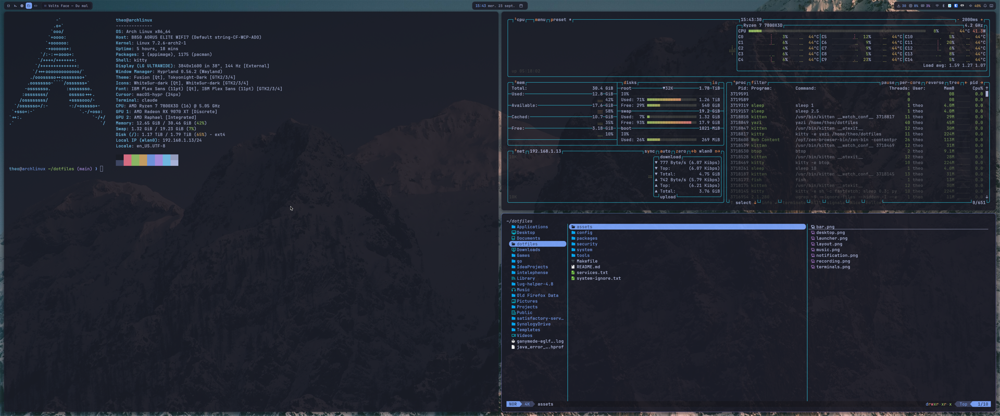
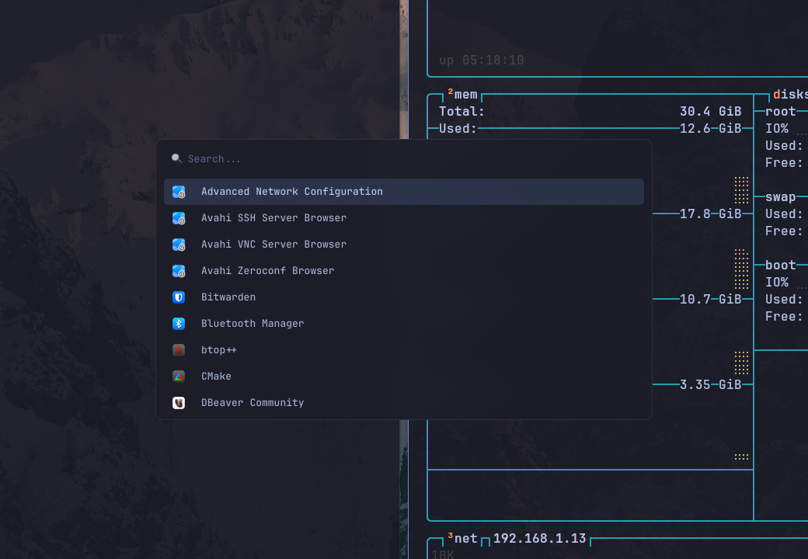
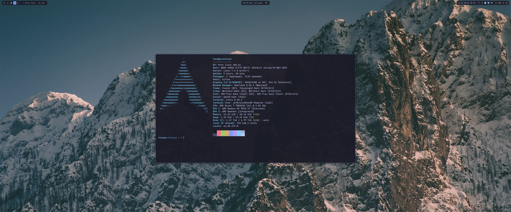
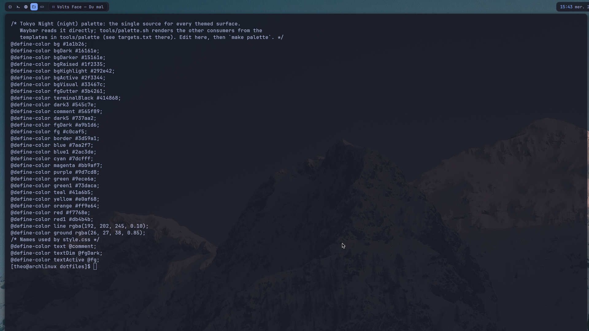
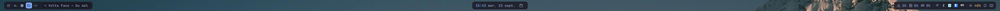
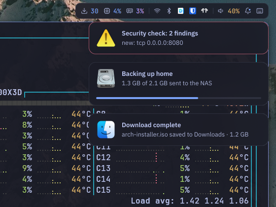
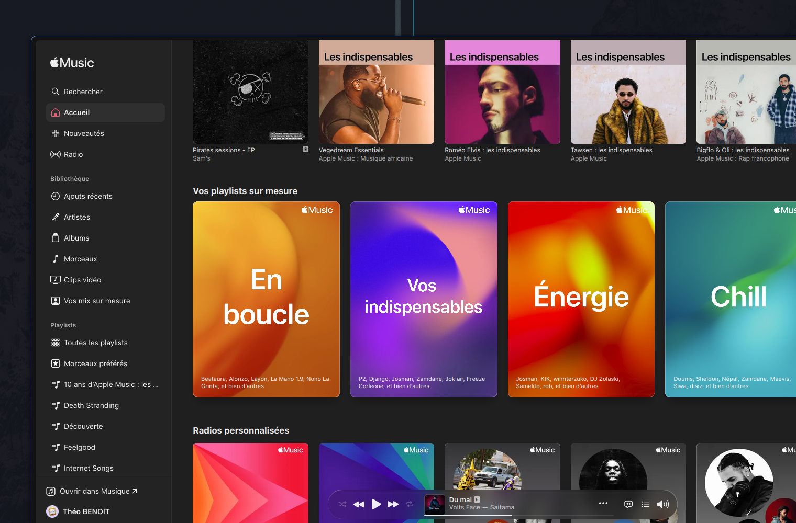
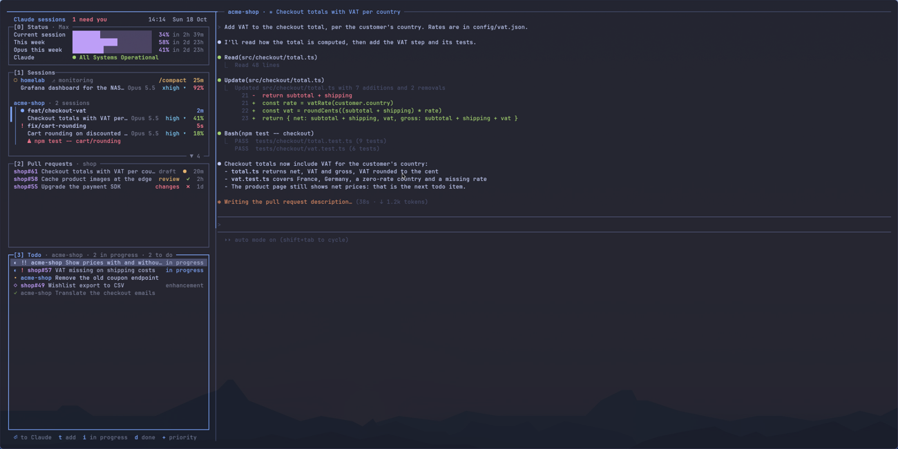
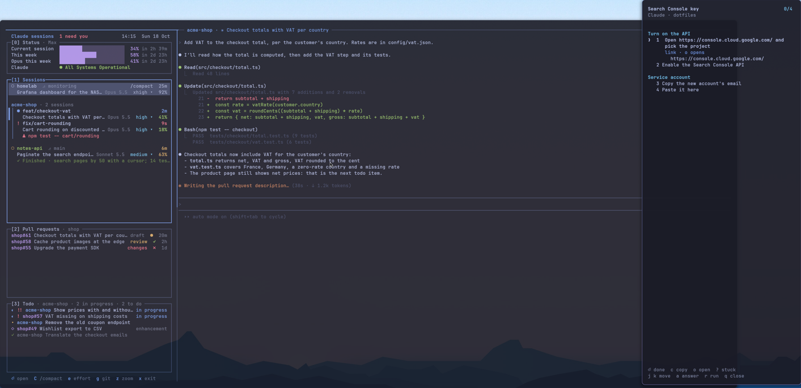

# dotfiles

Everything needed to rebuild my Arch Linux desktop running Hyprland: user dotfiles, system files under `/etc`, package lists for eight package managers, and a Makefile that provisions, audits and cleans the machine.



> [!WARNING]
> This is a personal setup for one machine: AMD CPU, Realtek RTL8922AE Wi-Fi, LG ultrawide, French keyboard.
> Several files hardcode `/home/theo` and expect the repo at `~/dotfiles`.
> Borrow freely, but read before running `make setup` elsewhere: it overwrites files in `/etc`.

## What's inside

| Path | Contents |
| --- | --- |
| [`config/`](config) | One [GNU Stow](https://www.gnu.org/software/stow/) package per program, symlinked into `~` |
| [`system/`](system) | Files installed under `/` as root: boot, initramfs, locales, pacman, networking, Bluetooth, SDDM, keyd |
| [`packages/`](packages) | Package lists for pacman, AUR, npm, pnpm, pip, cargo, go, composer and agent skills |
| [`services.txt`](services.txt) | System units enabled beyond their vendor preset |
| [`system-ignore.txt`](system-ignore.txt) | `/etc` paths deliberately left out of the repo, each with a reason |
| [`Makefile`](Makefile) | Provision, capture, audit and clean the machine; `make help` lists every target |
| [`tools/`](tools) | Helpers for the Makefile: the `make help` renderer, the palette generator, the security check, the README screenshots |

The desktop itself:

- **Hyprland** with hypridle, hyprlock, hyprsunset and a wallpaper that rotates every 30 minutes
- **Waybar**, the **Walker** launcher with Elephant providers, and **swaync** notifications
- **kitty**, **fish** and **helix**, plus lazygit, btop, fzf, bat, delta, yazi and tmux, all on the same palette
- **Mac-style shortcuts** through keyd, with Ctrl and Command swapped
- **Calendars** synced by vdirsyncer, shown in khal, with desktop notifications
- **Hardware extras**: an OpenRGB profile at boot, the Thermalright LCD, AirPods kept as the default audio sink
- **Boot**: the SDDM `silent` theme with an on-screen keyboard



## Design

One palette, Tokyo Night (night), applied the same way everywhere:

- **Tokens** live in [`config/waybar/.config/waybar/colors.css`](config/waybar/.config/waybar/colors.css). `make palette` renders kitty, GTK, qt6ct, swaync, Walker, Hyprland, fish, lazygit, fzf, btop, the OSD, slurp and Zen from the templates in [`tools/palette`](tools/palette); `make check-palette` reports drift.
- **Ground** `#1a1b26` at 85 % behind blurred islands, a `rgba(192, 202, 245, 0.10)` hairline, radius 10.
- **Icons are muted** (`#a9b1d6`), **values carry the colour**: blue for CPU, purple for GPU, yellow for volume, red for recording.
- **One colour family per element**, no gradients across families.
- **The grid**: 15 px outer gaps, 6 px between the bar and the windows, 8 px between islands.
- **Type**: SF Pro Text in the interface and notifications, JetBrainsMono Nerd Font in the bar and terminals.












## Keybindings

`Super` is the physical Command key: keyd swaps it with Ctrl, so Hyprland sees these as `CTRL`. `Super + Ctrl + K` (or the keyboard icon at the end of the bar) shows this list on screen, and choosing an entry runs it; it comes from `hyprctl binds` and the `description` of each bind in [`bindings.lua`](config/hyprland/.config/hypr/bindings.lua).

| Keys | Action |
| --- | --- |
| `Alt + 0` | Workspace 10 |
| `Alt + 1` | Workspace 1 |
| `Alt + 2` | Workspace 2 |
| `Alt + 3` | Workspace 3 |
| `Alt + 4` | Workspace 4 |
| `Alt + 5` | Workspace 5 |
| `Alt + 6` | Workspace 6 |
| `Alt + 7` | Workspace 7 |
| `Alt + 8` | Workspace 8 |
| `Alt + 9` | Workspace 9 |
| `Alt + F` | Fullscreen |
| `Alt + G` | Game mode by hand (it turns on by itself when a game opens) |
| `Alt + J` | Toggle window split |
| `Alt + Q` | Terminal |
| `Alt + Scroll down` | Next workspace |
| `Alt + Scroll up` | Previous workspace |
| `Alt + Shift + 0` | Move window to workspace 10 |
| `Alt + Shift + 1` | Move window to workspace 1 |
| `Alt + Shift + 2` | Move window to workspace 2 |
| `Alt + Shift + 3` | Move window to workspace 3 |
| `Alt + Shift + 4` | Move window to workspace 4 |
| `Alt + Shift + 5` | Move window to workspace 5 |
| `Alt + Shift + 6` | Move window to workspace 6 |
| `Alt + Shift + 7` | Move window to workspace 7 |
| `Alt + Shift + 8` | Move window to workspace 8 |
| `Alt + Shift + 9` | Move window to workspace 9 |
| `Alt + Shift + H` | Toggle HDR |
| `Alt + Shift + S` | Scratch workspace |
| `Alt + Shift + TAB` | Previous workspace |
| `Alt + TAB` | Next workspace |
| `Alt + W` | Close window |
| `Ctrl + down` | Focus down |
| `Ctrl + left` | Focus left |
| `Ctrl + right` | Focus right |
| `Ctrl + Shift + down` | Move window down |
| `Ctrl + Shift + left` | Move window left |
| `Ctrl + Shift + right` | Move window right |
| `Ctrl + Shift + up` | Move window up |
| `Ctrl + up` | Focus up |
| `Super + ²` | Dropdown terminal |
| `Super + Ctrl + B` | Bluetooth picker |
| `Super + Ctrl + C` | Calculator |
| `Super + Ctrl + E` | Emoji picker |
| `Super + Ctrl + K` | Keybinding cheat sheet |
| `Super + Ctrl + Q` | Power menu |
| `Super + Ctrl + SPACE` | Emoji picker |
| `Super + Ctrl + V` | Clipboard history |
| `Super + Ctrl + W` | Wi-Fi picker |
| `Super + M` | Apple Music |
| `Super + Shift + 3` | Screenshot the monitor |
| `Super + Shift + 4` | Screenshot an area or a window |
| `Super + Shift + 5` | Start / stop recording |
| `Super + SPACE` | Launcher |
| `XF86AudioLowerVolume` | Volume down |
| `XF86AudioMicMute` | Mute the microphone |
| `XF86AudioMute` | Mute |
| `XF86AudioNext` | Next track |
| `XF86AudioPause` | Play / pause |
| `XF86AudioPlay` | Play / pause |
| `XF86AudioPrev` | Previous track |
| `XF86AudioRaiseVolume` | Volume up |
| `XF86MonBrightnessDown` | Brightness down |
| `XF86MonBrightnessUp` | Brightness up |

## Claude Code cockpit

Workspace 6 is a cockpit for every Claude Code session on the machine. `claude-sessions` keeps a tmux session, `claude-manager`, with a column of panels on the left and the selected session on the right. Every session runs inside greywall; Claude Code hooks report each session's state to the OSD daemon, which keeps the registry the column reads.






The screenshots come from `tools/capture-claude.sh`, which builds a made-up cockpit (`claude-demo` in `apps/cockpit`: invented sessions, todos, pull requests and usage) in a tmux server and a home folder of its own, so no real session, task or cost appears.

### The column

| Key | Panel | What it shows |
| --- | --- | --- |
| `0` | Status | Plan usage per window (5 hours, week, per model), the cost at API prices today, this week, this month and all time, and Claude's own status from [status.claude.com](https://status.claude.com); `o` opens that page |
| `1` | Sessions | One card per running session: state, project, branch, title, model, effort (click to change), context use, and badges for `/compact`, an installed update, a needed restart, Remote Control, pins, `◆ figcraft` on the sessions of the project the running FigCraft serves, when it answers (the hook checks the connection inside the sandbox at each event; every session has the server, so the others show nothing) and commits not pushed yet (`↑2 unpushed`, counted by the hook inside the sandbox at each start and turn end, cleared by a `U` push). Once a turn ends, the card says what it left: commits, uncommitted changes, whether its last test run passed or failed, and a todo item closed (worked out by the hook inside the sandbox, from git and the turn's transcript). A repository's sessions sit under one heading |
| `2` | Pull requests | The pull requests of the sessions' repositories, with CI and review state; `c` starts a review session in a separate clone |
| `3` | Todo | Typed items and the open GitHub issues of the viewed session's project, by priority (`+` up to `!!!!`), in tabs (`[` `]`): Proposed · To do · In progress · Done. An item has a title and notes, written in your editor in a popup (`t` adds, `e` edits); Enter shows its details, `h` hands it to Claude. Claude updates the list itself with `claude-todo`, and proposes ideas (`claude-todo propose`, with why) that wait in Proposed for `y` (approve) or `n` (decline; not proposed again). `Q` queues an item: a session of its project idle at its prompt for 5 minutes takes the first queued one by priority, one at a time (never the session on screen). In a project designed in FigCraft, sessions declare their role (`claude-design role designer|developer`, shown `✎ designer` / `⌨ developer` on the card); a gap a developer finds in the design is filed with `--design` (`✎ design` on the row), and `h` or the queue hand it to the designer session, starting one with the `figcraft-design` skill when none runs. A session of any project that the setup blocks (greywall, claude-sessions, the launcher…) files `claude-todo blocked '<what>' --why '<what stopped it>'`: the report lands in the dotfiles list (`⛔ <project>`), queued for the dotfiles session, which gets it framed as data from another session (the same open report once, 3 open per project at most) |

A session started with `claude` and `t` ("this terminal") still gets a card (badge `▭ terminal`) you can open and message, but `⌘R`, the reboot restore, the Todo queue and the error hand-off leave it alone, and `ask-to-run` / `ask-to-guide` are not available in it: Claude gives you the command or the steps instead. An approval pane shows only under the session that asked, and follows you back to it.

Above the cards, the Sessions panel warns about requests greyproxy is holding, sessions to bring back after a reboot (`B`), a Claude incident, and sessions started before a change to CLAUDE.md, the settings, plugins, hooks or the sandbox (`⌘R` restarts the ones waiting at their prompt).

Sessions keys: Enter opens a session, `n` peeks at the next one waiting for you, `a` starts one in a project, `A` / `+` another one on the same repository in its own clone, `r` restarts in place, `e` changes the effort, `x` exits, `R` toggles Remote Control, `p` pins, `g` opens lazygit (inside greywall: review and commit, but no push, since the sandbox has no SSH key), `U` pushes the session's branch to its GitHub origin with your key after a yes (hooks off, settings that could run a program reset), `C` sends `/compact`, `z` zooms, `Y` / `N` answer a permission request, `m` sends a message (while the session works it waits, `✉ N queued` on the card, and goes out when the turn ends, one per turn; Alt+Q inside a session does the same, `M` drops the queue), `f` keeps only the sessions waiting for you. Everywhere: `H` resumes a past session (searchable), `/` filters, `:` lists every action, `D` shows the daily digest, `S` the settings (on or off, also `claude-sessions setting`: Remote Control on lock, the todo queue, errors handed to dotfiles, freezing sessions while gaming, the idle lock on workspace 6, the daily digest), `K` lists the clones of `A`, `+` and reviews and deletes, after a yes, those with no session, no uncommitted change and nothing unpushed (checked by git inside greywall), `P` `W` `G` open the pull requests, Claude on the web and greyproxy's dashboard, `?` the help.

Moving around (⌘ is the physical Command key, which keyd turns into Ctrl): ⌘Tab between the column and the session, ⌘1/2/3 to a panel from inside the session, `l` or → into the session, ← back to the column.

### Out of the sandbox, with my approval

| Command (inside a session) | What happens outside |
| --- | --- |
| `ask-to-run --why '…' '<command>'` | An approval terminal shows the command and Claude's explanation, in a pane under the session in the cockpit and in a floating window elsewhere. Nothing runs without "Run it"; the output then goes back to Claude, with tokens, keys, passwords and credentials replaced by `[redacted]` first. Hidden characters are shown escaped |
| `ask-to-guide` | Steps I do by hand (a browser, a console) in a floating window, one at a time, with links to open, values to copy and questions to answer; the answers, or the step I got stuck on, go back to Claude |
| `claude-todo start/done/add` | Updates the Todo panel |
| `craft-open figcraft [--session <id>]` (through `ask-to-run`) | Starts FigCraft on its control port 7979, its files limited to the session's project, for the `figcraft-app` MCP server every session has (the launcher forwards 7979 only into the sandboxes of the project FigCraft serves); never replaces a FigCraft that is open, nor starts one while a sandbox of another project still has the port. `--session` restarts a session whose server had exited (FigCraft was closed at its start) once its turn ends, then tells it to carry on. Tell a session "connect to FigCraft" |

Files the sandbox cannot write (CLAUDE.md, hooks, greywall, fish, systemd) go through `.handoff/` and `make handoff-install`, which shows each diff and asks first.

Nothing outside the sandbox runs git on a session's folder, since a session can write that repository's configuration: the hook works out what a turn changed inside the sandbox, the daemon reads project names from the `.git` files, `g` opens lazygit inside greywall, `A` and `+` switch a clone's branch inside greywall, `K` checks clones inside greywall, and a pull request review (`c`) always gets a fresh clone, so its fetch (which needs your credentials) never runs in a folder a session had.

What sessions can and cannot do to the machine (audits of 2026-10-18 and 2026-10-19):

- They report their state on a socket (`osd-report.socket`): the daemon asks the kernel which process sent a report and takes the tmux pane from its first ancestor outside the sandbox, so no session can claim another's pane or card. Requests go on `osd.fifo`; banners, focus, clearing the column and approval phases only come through `osd-host.fifo`, which no sandbox can open.
- `~/.ssh/known_hosts` is read-only for sessions.
- Theo's answers (run results, guide progress) go to `$XDG_RUNTIME_DIR/claude-answers/<project>`, written only outside the sandbox: each sandbox has its own project's folder mounted read-only and sees no other, so no session forges an approved output or reads another project's.
- `~/.claude/projects/<folder>` of every other project (memory, transcripts) is read-only in a session: the launcher writes a settings file of its own per project (`$XDG_RUNTIME_DIR/greywall-agents`), greywall.json plus those folders in `denyWrite`. Memory found for a fresh parallel clone is set aside.
- `.git/config` and `.git/hooks` are read-only in the folder a session starts in; every host git call in claude-sessions resets the settings that run a program, and a push redirected by a push URL or URL rewrite is refused.
- A session's folder (and so where a restart resumes it, with which project's token) is the folder its sandbox started in, read from `/proc`, never the one a report claims.
- Commands are shown as they run: run through `sh` exactly as quoted, in the folder resolved before Theo answers, with hidden characters, blank-line padding and non-ASCII letters flagged; output goes back with secrets redacted.
- Claude Code updates only from outside the sandbox (`claude-update.timer`); sessions cannot write the versions folder.
- `make system` and `make handoff-install` show every file (new ones whole, control characters visible) and refuse setuid bits and symlinked destinations.
- Todo items lose control characters, show "by Claude" when a session filed them, and go to sessions by folder, never by project name; the queue waits while Theo games.

Dotfiles changes (audit of 2026-10-19, `docs/security-audit-2026-10-19.md`): no session runs in `~/dotfiles`, the live checkout stowed into `~/.local/bin` and `~/.config` (the launcher refuses it). Claude's dotfiles session works in the clone `~/IdeaProjects/dotfiles` (`make dotfiles-work` creates it), exports its commits with `git format-patch origin/main -o .outgoing`, and `claude-sessions apply-dotfiles` (through `ask-to-run`) shows them with control characters visible and applies them to `~/dotfiles` with `git am` after a yes. No host git runs in the clone. Still open from that audit: every session can write `~/.claude.json`, the memory folders and the shared todo updates (fixes planned in the audit's order). Also accepted (2026-10-19): `jobpilot-apply.timer` runs `~/IdeaProjects/jobpilot` code hourly with my rights, code that a Claude session working in jobpilot can edit.

### Around it

- **Banners** at the top of the screen when a session needs me or finishes, held during a meeting (khal) or a game.
- **A loading screen** over the session pane while a session restarts, changes effort or starts.
- **Error hand-off**: an error in the claude-sessions log goes to a dotfiles session to be fixed, once a day per error and three a day at most.
- **Idle**: workspace 6 locks after 10 minutes, after a full-screen "Still there?" prompt; a lock hands the sessions to Remote Control (unless the setting `handoff-on-lock` is off).
- **Web windows** for pull requests, Claude on the web and greyproxy, one tab each.
- **Waybar** shows the sessions and the plan usage.
- **Health**: `claude-sessions doctor` checks every piece, `claude-sessions logs` shows the log, and a weekly timer runs the checks.

### Where it lives

| Path | Role |
| --- | --- |
| [`config/bin/.local/bin/claude-sessions`](config/bin/.local/bin/claude-sessions) | The manager: tmux layout, start, resume, restart, logs, doctor |
| [`apps/cockpit`](apps/cockpit) | The Rust programs, built with `make cockpit`: the column (Ratatui), the approval terminal, the guide window and the sandbox commands; each name in `config/bin/.local/bin` is a two-line wrapper that runs its build |
| [`apps/desktop`](apps/desktop) | The GTK programs: the OSD daemon (banners, the session registry, the run and guide queues), the now-playing card, the idle screen, the web placeholder |
| [`config/claude/.claude/hooks`](config/claude/.claude/hooks) | `session-state.sh` reports states; `agent-environment.sh` tells a session what its sandbox has |
| [`config/bin/.local/bin`](config/bin/.local/bin) | `ask-to-run`, `claude-run-approve`, `ask-to-guide`, `claude-guide`, `claude-todo`, `claude-design`: wrappers of the Rust builds |
| [`config/tmux/.config/tmux/tmux.conf`](config/tmux/.config/tmux/tmux.conf) | The cockpit's keys |
| [`config/hyprland/.config/hypr/apps/claude.lua`](config/hyprland/.config/hypr/apps/claude.lua), [`scratchpads.lua`](config/hyprland/.config/hypr/scratchpads.lua) | Workspace 6, window rules, the web windows |
| [`config/systemd/.config/systemd/user`](config/systemd/.config/systemd/user) | `osd`, `claude-sessions`, the health check, the version link |
| [`apps/cockpit/tests`](apps/cockpit/tests), [`apps/desktop/src/tests.rs`](apps/desktop/src/tests.rs) | `make test`: the scripts, hooks and programs through fake commands on PATH, and the daemon's registry |

## Games

A game window opening turns **game mode** on by itself (`config/hyprland/.config/hypr/game-mode.lua`), and the game's exit turns it off:

- Hyprland drops animations, blur and rounding; banners and approval windows wait.
- Feral GameMode (`config/gamemode`) puts the CPU governor and the GPU (`card1`) in their performance modes while the game's process runs.
- `game-performance` (GameMode's start and end hooks) pauses the Claude sessions (cgroup freezer on each session's tmux scope: they resume mid-step after the game; the column and approval panes stay usable), the backup, jobpilot and the update, security and health checks, and drops any job already running to idle CPU and disk priority. The Todo queue waits too. `game-performance off` thaws by hand; the cockpit doctor flags sessions left frozen.
- MangoHud (`config/MangoHud`): FPS, frame times, CPU and GPU load and temperatures, with `Right Shift + F12`. Only Steam and its games load it (`config/steam` sets `MANGOHUD=1` in Steam's launcher).

## Machine monitor (vitals)

`vitals` ([`apps/vitals`](apps/vitals)) watches the machine so a cooling or hardware problem shows up before it does damage. `Ctrl + Cmd + M` (or the bar's chip) opens its TUI, in French: **Aperçu** (the machine in plain words, then every temperature with its 24 h range and limit, the pump, fans, load), **Refroidissement** (CPU and GPU over 90 days, and the idle trend), **Disques** (SMART health, space), **Système** (failed services, kernel errors, memory, the backup), **Entretien** (upkeep on a schedule), **Jeux** (each game session with its peaks: CPU, GPU, hotspot, VRAM, GPU power, minutes at a limit) and **Journal** (crashes, hard stops, programs killed for memory, GPU hangs, and the alerts that ended, over 30 days, each tagged with the game running at the time). Aperçu also lists the GPU's power, clock and video memory use.

Aperçu opens with a headline ("Ton PC va bien : rien à faire.") and one sentence each for cooling, disk, system, backup, upkeep and stability (the last 7 days of the Journal), saying what to do when something drifts: a CPU idling 5 °C warmer than two weeks ago means dusting the filters and the radiator, then checking the pump.

| Upkeep (Entretien tab) | Every |
| --- | --- |
| Dépoussiérer les filtres et les ventilateurs | 3 months |
| Nettoyer le radiateur | 6 months |
| Vérifier le watercooling (pump noise, tubes, joints) | 6 months |
| Refaire la pâte thermique du CPU | 3 years |
| Tester la restauration d'une sauvegarde | 6 months |
| Chercher une mise à jour du BIOS | 6 months |

`d` records a task done today, `b` moves its date a week earlier (for one done a while ago). A task past its interval raises a banner and the bar's chip like any problem; one never recorded only asks for its date.

| Check | Warns when |
| --- | --- |
| Limits | A temperature stays at its limit for 3 minutes (the driver's, else 90 °C for the CPU, 85 °C otherwise); critical at the driver's critical limit |
| Idle trend | The idle temperature (10th percentile of idle minutes) of the last two weeks is 5 °C above the two before: dust, the pump, the paste |
| Load trend | The temperature under the same load (≥ 70 %) is 5 °C above three weeks earlier |
| Fans | A fan or pump that spun this week reads 0 RPM while its chip is above 60 °C |
| Pump | The pump's idle speed this week is 15 % under three weeks earlier: it slows down before it stops |
| Disks | A SMART critical warning, spare blocks under their threshold, 80 % wear, new media errors, a file system over 90 %, or one that will be full within 30 days at the pace of the last two weeks |
| System | Failed services, kernel GPU resets, disk I/O errors, machine checks, programs killed for memory or throttling, low memory or memory pressure, no successful backup in two days |

- `vitals-collect.timer` (user, every minute) runs `vitals collect`: one SQLite file in `~/.local/state/vitals`, every reading for 35 days and hourly summaries for good. A new problem raises a banner (held while gaming) and a chip in the bar until it clears.
- `vitals-root.timer` (system, every 10 minutes, in `system/`) runs only `smartctl`, `journalctl` and `coredumpctl` as root and leaves their output in `/var/lib/vitals`: no program from the dotfiles runs as root.
- `vitals-shutdown.service` (user) records the boot when the session starts and again when it stops cleanly; a boot recorded only at the start was a hard stop (a freeze, a power cut, the power button held).
- A game session runs while GameMode has the machine (game-performance's list in `$XDG_RUNTIME_DIR`) or a game window has the focus; its name is the game window's title.
- Pump and fan speeds come from the motherboard's fan chip (ITE IT8696E) through the community `it87` driver (AUR `it87-dkms-git`, loaded at boot by `system/etc/modules-load.d/it87.conf`; the kernel's own `it87` does not know this chip). Header 5 carries the pump; the case fans hang off the cooler, out of its sight.
- `vitals import` loaded the temperature log kept since February (`log-temps.sh`, now retired with `check-temp-trends`).

## Quickstart

### Prerequisites

- A base Arch install with network access, a user in the `wheel` group, and `git` and `base-devel` installed
- [yay](https://github.com/Jguer/yay), which `make` uses for AUR packages:

  ```bash
  git clone https://aur.archlinux.org/yay.git /tmp/yay
  cd /tmp/yay && makepkg -si
  ```

- The secret files that some configs read, which never go in the repo:

  | File | Used by |
  | --- | --- |
  | `~/.secrets/airpods` | `make dotfiles`, to generate the WirePlumber AirPods rule |
  | `~/.secrets/icloud.env` | vdirsyncer, iCloud calendar |
  | `~/.secrets/restic` | Backups: the password of both repositories, see [Backups](#backups) |

  `~/.secrets/airpods` holds a single line: `AIRPODS_MAC="XX:XX:XX:XX:XX:XX"`.

### Install

```bash
git clone https://github.com/Androlax2/dotfiles.git ~/dotfiles
cd ~/dotfiles
make setup
```

`make setup` runs these targets in order, and each one can also be run on its own:

1. `packages` installs the pacman and AUR packages
2. `dotfiles` links every `config/` package into `~`
3. `global-packages` installs the npm, pnpm, pip, cargo, go and composer packages, and the agent skills in `packages/skills.txt`
4. `system` copies `system/` into `/` as root
5. `locale` generates the locales enabled in `/etc/locale.gen`
6. `services` enables the units in `services.txt`
7. `initramfs` rebuilds the initramfs after the `system/etc/mkinitcpio.conf` copy

Then finish the [manual steps](#manual-steps) and reboot.

### Verify

```bash
make check
```

Each section should be empty. Anything listed is drift between the machine and the repo.

## Everyday use

```bash
make update   # upgrade pacman and AUR packages
make update-skills   # upgrade the agent skills installed with the skills CLI
make check    # what changed on this machine that the repo doesn't know about?
make dump     # write those changes into the repo, then review them with git diff
make disk     # where is the disk space going?
make clean    # remove orphans, old package caches, dev tool caches, journal older than 4 weeks
```

`make clean` asks before removing packages. Two cleanups stay separate because they destroy data:

```bash
make clean-docker   # stopped containers, unused images, and every unused volume with its data
make clean-trash    # empty the desktop trash for good
```

### Keeping the repo in sync

After installing something or editing a config, run `make check`, then `make dump`, and commit what `git diff` shows.

`make dump` rewrites the package lists, `services.txt` and the files already in `system/`.
It also captures [agent skills](#agent-skills).
It never picks up a new `/etc` file by itself. `make check` lists those instead, and each one needs a decision:

- **Track it** by copying it into `system/` at the same path:

  ```bash
  install -D -m 644 /etc/foo/bar.conf system/etc/foo/bar.conf
  ```

- **Ignore it** by adding a regex and the reason to `system-ignore.txt`.

`.pacnew` files and editor leftovers are never ignored: merge or delete them.

### Adding a program's config

Move its config into a new stow package, then relink:

```bash
mkdir -p config/foo/.config
mv ~/.config/foo config/foo/.config/
make dotfiles
```

Don't stow files that programs rewrite by replacing them, such as `mimeapps.list`: the program replaces the symlink with a plain file.

### Agent skills

Skills for Claude Code and the other coding agents come from three places, and only the first two are versioned:

| Kind | Lives in | Versioned as | Restored by |
| --- | --- | --- | --- |
| Installed with the [skills CLI](https://github.com/vercel-labs/skills) | `~/.agents/skills`, linked into `~/.claude/skills` | One `owner/repo skill-name` line in [`packages/skills.txt`](packages/skills.txt) | `make global-packages` |
| Written by hand | `~/.claude/skills` | The files themselves, in [`config/claude/.claude/skills`](config/claude/.claude/skills) | `make dotfiles` |
| Synced from the Claude account | `~/.claude/skills/synced` | Not versioned | Claude Code, on login |

Install a skill from a repository, then record it:

```bash
npx skills add owner/repo --skill skill-name -g -a claude-code
make dump
```

`-a claude-code` is enough: the other agents read `~/.agents/skills` directly, and Claude Code is the only one that needs links elsewhere.

For a skill written by hand, create it in `~/.claude/skills/<name>` and run `make dump`: it moves the folder into `config/claude` and links it back, so later edits land in the repo.

`make check` reports both kinds: CLI skills under `packages`, hand-written ones under their own section.

The list records where each skill comes from, not its version. A fresh machine gets the latest version of each, and `make update-skills` upgrades them here. It is separate from `make update` on purpose: skills are instructions agents act on, pulled unpinned from many repositories.

## Backups

```text
PC ── restic over SFTP, daily ──> NAS share "restic"          (btrfs snapshots, immutable for 7 days)
PC ── restic over SFTP, daily ──> Hetzner Storage Box         (Storage Box snapshots)
NAS ── its own data, nightly, from the homelab repo ──> Hetzner Storage Box
```

- **Two independent copies of the PC.** The NAS and Hetzner each hold a separate restic repository, so losing either one, or the NAS with the house, still leaves a backup.
- **The NAS backs up its own data.** Photos, apps and databases leave the NAS through the [homelab repository](https://github.com/Androlax2/homelab#backups), not from this machine.
- **Encrypted on the PC.** restic encrypts and deduplicates before upload: the NAS and Hetzner only store ciphertext.
- **Everything in `~` is backed up** except the caches, game installs, programs and build output listed in [`excludes.txt`](config/restic/.config/restic/excludes.txt). `make backup-list` shows the size of every included folder, and `make backup-list DEPTH=2` shows fewer levels.
- **One script does the work.** [`backup.sh`](config/restic/.config/restic/backup.sh) runs behind the `make backup*` targets and both timers.

| Job | When | Keeps |
| --- | --- | --- |
| Backup to both, `restic-backup.timer` | 15 minutes after boot, then daily | Every run until maintenance |
| Maintenance on both, `restic-maintenance.timer` | Sundays at 14:00, or at the next boot if missed | 7 daily, 4 weekly and 12 monthly snapshots |
| NAS snapshots of the `restic` share | Daily | 14 days, immutable for 7 |
| Storage Box snapshots | Automatic, set in Hetzner Console | Up to 10 |

A target that can't be reached, away from home or offline, is skipped quietly while the other still runs. After 3 days without a backup to a target you get a notification, and any failure sends a critical one.

> [!CAUTION]
> The backups can't be decrypted without `~/.secrets/restic`. Keep a copy outside the NAS, for example on paper stored away from home: Bitwarden here is the Vaultwarden instance running on the NAS, so it disappears with it.

### First-time setup

On the NAS, in DSM:

1. In Control Panel, open Shared Folder and create `restic` on Volume 1, with data checksum on and read/write access for your account.
2. In Control Panel, open File Services, then FTP, and enable SFTP.
3. In Snapshot Replication, schedule daily snapshots of `restic`, kept 14 days and immutable for 7.

On Hetzner:

4. In Hetzner Console, open the Storage Box and turn on **External Reachability** and **SSH Support**. Without External Reachability, only machines inside Hetzner's network can connect.
5. In the Storage Box's Snapshots tab, turn on automatic snapshots. This machine holds an SSH key to the box, so snapshots are what protect the backups if it is compromised.

On the PC:

6. Install restic and record it in the package list:

   ```bash
   sudo pacman -S restic
   make dump-packages
   ```

7. Generate the repository password, then store a copy outside the NAS:

   ```bash
   (umask 077 && head -c 32 /dev/urandom | base64 > ~/.secrets/restic)
   ```

8. Name the Storage Box `storagebox` in `~/.ssh/config`, with the username from Hetzner Console. Use port 23: there the box accepts the usual one-line OpenSSH key, while port 22 only accepts keys in RFC4716 format:

   ```text
   Host storagebox
       HostName u000000.your-storagebox.de
       Port 23
       User u000000
   ```

   Add this machine's public key, as its one-line `.pub` file, to the box's `.ssh/authorized_keys`. Then connect once to accept its host key, since restic can't answer that prompt:

   ```bash
   sftp storagebox
   ```

9. Create both repositories, check what would be uploaded, then run the first backup. Plug in Ethernet for this one, since it uploads everything twice:

   ```bash
   make backup-init
   ~/.config/restic/backup.sh run --dry-run -v
   make backup
   ```

10. Turn on the schedule:

    ```bash
    systemctl --user enable --now restic-backup.timer restic-maintenance.timer
    ```

### Restoring

Pick the target with `nas` or `hetzner`. They hold the same data, so use the NAS at home, since it's faster:

```bash
make backup-status
~/.config/restic/backup.sh restic nas restore latest --target /tmp/restore --include "$HOME/IdeaProjects/opusline"
```

To browse every snapshot as folders, mount a repository:

```bash
mkdir -p /tmp/restic-mount
~/.config/restic/backup.sh restic nas mount /tmp/restic-mount
```

If the NAS is lost, restore from Hetzner the same way, with `hetzner` as the target.

## Manual steps

These can't be automated safely, so they stay manual.

### Boot parameters

Loader entries contain the disk's PARTUUID, so they are not versioned:

```bash
sudoedit /boot/loader/entries/<date>_linux.conf
```

```text
options root=PARTUUID=... rw rootfstype=ext4 quiet thermal.off=1 acpi_enforce_resources=lax
```

- `quiet`: no boot splash, so this only hides kernel chatter.
- `thermal.off=1`: the board exposes one ACPI thermal zone reporting 17 °C, and probing it
  costs 2 s at every boot (`initcall_debug`). CPU temperatures come from k10temp, unaffected.
- `acpi_enforce_resources=lax`: lets OpenRGB and the Thermalright LCD reach the SMBus.

### Fonts

`system/` only tracks regular files, so the fontconfig links are created by hand:

```bash
sudo ln -s /usr/share/fontconfig/conf.avail/10-sub-pixel-rgb.conf /etc/fonts/conf.d/
sudo ln -s /usr/share/fontconfig/conf.avail/10-hinting-slight.conf /etc/fonts/conf.d/
sudo ln -s /usr/share/fontconfig/conf.avail/10-autohint.conf /etc/fonts/conf.d/
sudo ln -s /usr/share/fontconfig/conf.avail/11-lcdfilter-default.conf /etc/fonts/conf.d/
sudo ln -s /usr/share/fontconfig/conf.avail/75-apple-color-emoji.conf /etc/fonts/conf.d/
sudo fc-cache -fv
```

Don't enable `70-no-bitmaps.conf` or any other config that disables embedded bitmaps. Color emoji fonts such as Apple Color Emoji rely on them.

### Wi-Fi (RTL8922AE)

The `rtw89_8922ae` driver stalls when the access point changes channel or bandwidth.
Traffic stops, but the driver never reports a disconnect, so NetworkManager keeps showing the link as connected.

1. **Stop the Livebox from hopping channels.** On `http://192.168.1.1`, open Wi-Fi, then the 5 GHz advanced settings:
   - Fix the channel to 36, 40, 44 or 48, which avoid radar (DFS) channels.
   - Set the width to 80 MHz, because 160 MHz spans DFS channels and forces moves.
   - Turn off any smart channel or channel optimisation option.
2. **Let the PC recover on its own.** `make system` installs a NetworkManager dispatcher script that power-cycles the radio whenever the connectivity check fails while `wlan0` still claims to be connected. It also installs a module config that disables PCIe and driver power saving.

Check that the recovery works, and that the regulatory database loaded after a reboot:

```bash
journalctl -t wifi-reconnect
iw reg get   # should show "country FR", not "country 00"
```

### Software installed outside package managers

These came from vendor installers, so `make` can't reinstall them:

| Software | Location | Notes |
| --- | --- | --- |
| Claude Code | `~/.local/bin/claude` | Updates itself; CLI commands use the Greywall launcher in `~/.local/bin/greywall-agents` |
| Codex CLI | `~/.local/npm/bin/codex` | CLI commands use the Greywall launcher in `~/.local/bin/greywall-agents` |
| CodeRabbit CLI | `~/.local/bin/coderabbit` | `cr` is a symlink to it |
| greywall, greyproxy | `~/.local/bin` | The `opencode`, `codex`, and `claude` launchers in `config/bin` run through greywall; greyproxy is a user service |
| opencode | `~/.opencode/bin` | Started through `~/.local/bin/opencode` |
| Herd Lite | `~/.config/herd-lite` | PHP, Composer and the Laravel installer, added to `PATH` by `~/.profile` |
| uv | `/usr/local/bin` | `make clean-caches` uses it |
| Private Internet Access | `/opt/piavpn` | Its installer also writes `piavpn.service` and `wgpia.conf` |
| Thermalright LCD control | `/usr/local/bin` | Its unit file is versioned in `system/` |

## Notes

- **DNS** goes through systemd-resolved with Quad9 and Cloudflare, set in [`system/etc/systemd/resolved.conf`](system/etc/systemd/resolved.conf). NetworkManager hands DNS over to it through [`dns.conf`](system/etc/NetworkManager/conf.d/dns.conf).
- **User services and timers** are versioned with their enable links in [`config/systemd`](config/systemd/.config/systemd/user), so `make dotfiles` enables them too.
- **The wallpaper** is picked by `wallpaper-rotator.sh`, which writes `~/.config/hypr/wallpaper.conf`. That file is git-ignored because it changes every 30 minutes.
